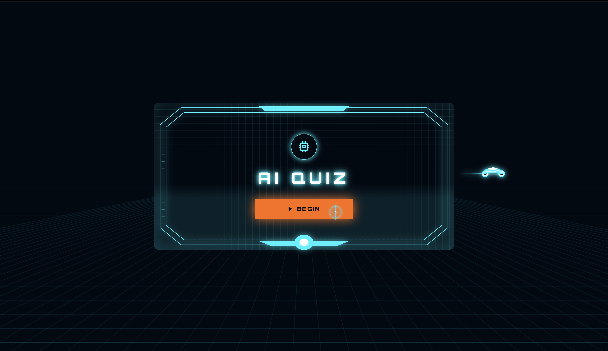
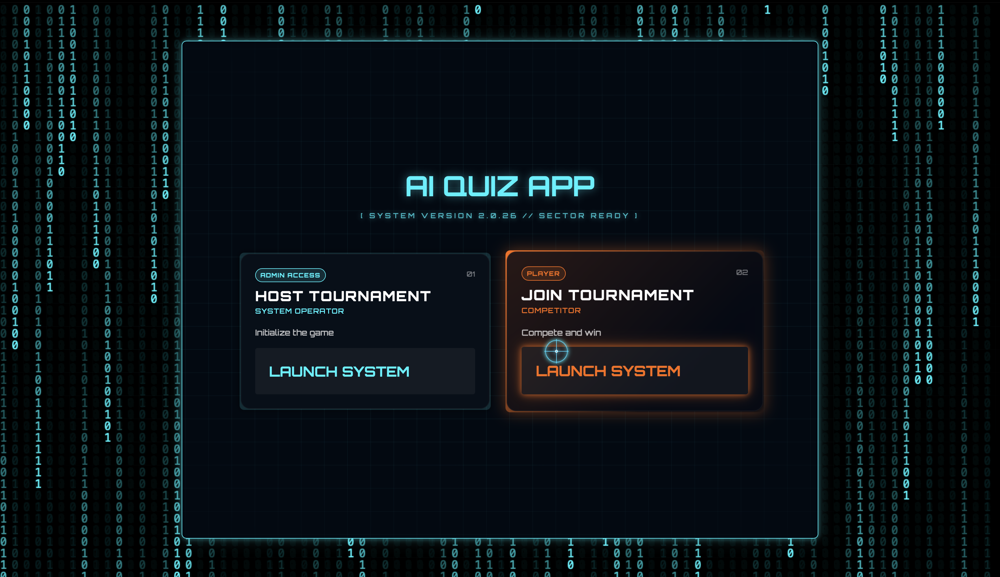
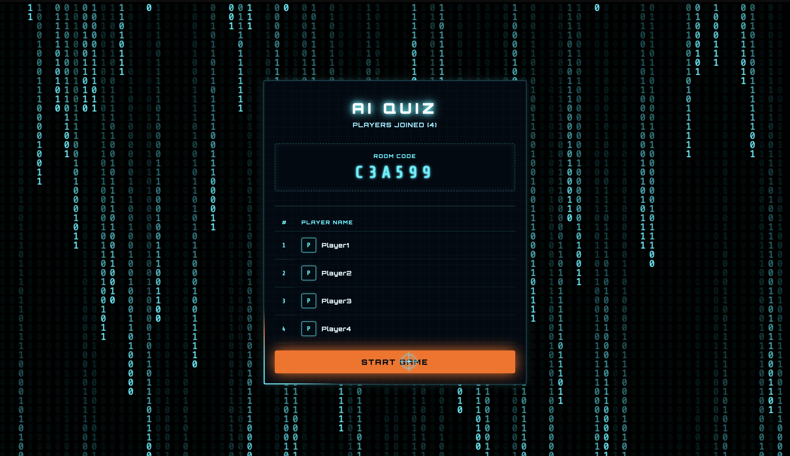
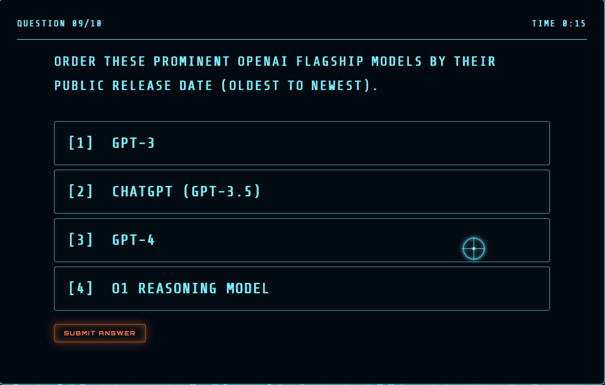
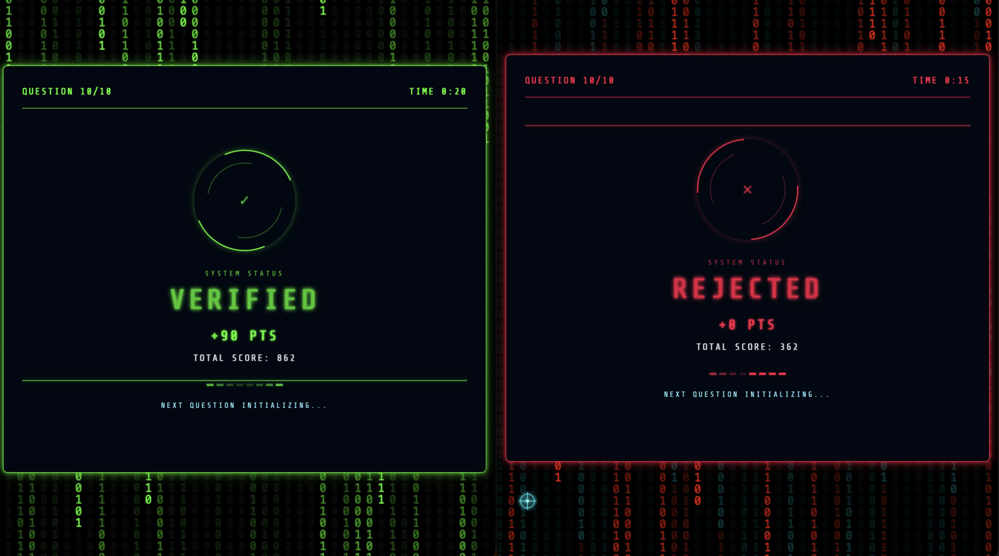

# AI Quiz Ruby

**A real-time multiplayer quiz backend for host-led, elimination-style games.**


AI Quiz Ruby coordinates live quiz sessions: a host creates a game, players join with a game code, and the server manages questions, scores, leaderboards, round elimination, and power-ups. JSON endpoints handle commands and queries, while Action Cable broadcasts keep connected clients informed without polling for every game event.

The bundled question bank covers artificial intelligence and related technology. Questions come from YAML; no AI model integration or automatic question generation is implemented.

This repository is an **API-only Rails application**. No browser dashboard, onboarding screens, or settings interface is included. The CORS configuration references a separate frontend hosted on Vercel.

<!-- TODO: add the frontend repository URL and confirm any public demo URLs. -->

## Contents

- [Features and demos](#features-and-demos)
- [Tech stack](#tech-stack)
- [Architecture](#architecture)
- [Getting started](#getting-started)
- [API and real-time integration](#api-and-real-time-integration)
- [Testing and quality checks](#testing-and-quality-checks)
- [Deployment](#deployment)
- [Roadmap](#roadmap)
- [Contributing](#contributing)
- [License](#license)

## Features and demos

These media links are placeholders. Record API requests and WebSocket events, or demonstrate the backend through a connected frontend. Create `docs/videos/` and `docs/images/` when adding media. Hide session tokens in recordings.

### 1. Host and player sessions

Hosts register with a name and receive a generated token. Players receive a separate token when joining a game. Protected HTTP actions use bearer authentication, and rejoin endpoints restore active game context. Completed games reject rejoin requests.

**Technologies and patterns:** Active Record `has_secure_token`, shared authentication methods in `ApplicationController`, bearer headers, token-based session recovery. Current authentication does not use passwords or JWTs.

**Demo focus:** create a host, join as a player, then restore both sessions using saved tokens.

<!-- TODO: add demo video for Host and Player Sessions -->
[▶ Watch the Host and Player Sessions demo](docs/videos/sessions.mp4)




### 2. Game creation and multiplayer lobby

An authenticated host creates a game with a generated six-character uppercase hexadecimal code. Players join using that code and a username unique within the game. Games default to eight players, and the join endpoint checks the configured limit. Creating a game copies the YAML question bank into game-specific rounds, questions, and options.

Lobby broadcasts announce game creation, the host, and joined players. A player-list endpoint supplies IDs and usernames, including for opponent selection.

**Technologies and patterns:** Active Record associations and callbacks, `SecureRandom`, player counter cache, `QuizPopulator`, Action Cable publish/subscribe events.

**Demo focus:** create a game, copy its code, and show several players joining the same lobby.

<!-- TODO: add demo video for Multiplayer Lobby -->
[▶ Watch the Multiplayer Lobby demo](docs/videos/multiplayer-lobby.mp4)



### 3. Live, host-controlled game progression

The host advances through ordered questions, periodic leaderboards, round summaries, and completion. `Game#advance_step!` locks the game record while transitioning and records question start times. The advance endpoint broadcasts the resulting status, current round, current question, and start timestamp.

Authenticated WebSocket connections subscribe to `GameChannel` using a game code. Subscription checks restrict hosts to their own games and players to games they belong to.

**Technologies and patterns:** Action Cable, room-scoped streams, enum-based state transitions, pessimistic locking with `with_lock`, transition service objects.

**Demo focus:** subscribe two clients, start a game, and show both receiving the same updates as the host advances.

<!-- TODO: add demo video for Live Game Progression -->
[▶ Watch the Live Game Progression demo](docs/videos/live-game-progression.mp4)


### 4. Question bank and content APIs

The YAML bank contains three rounds: Qualifiers, Semi-Finals, and Core AI Concepts & Learning Paradigms. Round and question endpoints expose nested question/option data and support creating content; question endpoints also support updates. Default question and round JSON excludes correct option positions.

| Question type | Submitted answer | Current grading behavior |
| --- | --- | --- |
| `true_false` | An option position | Checks membership in correct positions |
| `single_choice` | An option position | Checks membership in correct positions |
| `drag_drop_order` | An ordered array of option positions | Requires an exact sequence match |
| `type_the_answer` | A string | Trims whitespace and compares accepted option text without case sensitivity |
| `multiple_choice` | Not fully implemented | Defined in the model enum, but the grader currently falls through to an incorrect result |

Options support an Active Storage image attachment and include `image_url` in JSON. Development and production select Cloudinary storage; tests use temporary disk storage. Question parameters do not currently expose image attachment uploads.

**Technologies and patterns:** YAML-driven content, `QuizPopulator`, nested attributes, enum question types, model JSON serialization, Active Storage and Cloudinary.

**Demo focus:** inspect a round, create or edit a question, and show the four implemented answer formats.

<!-- TODO: add demo video for Question Bank -->
[▶ Watch the Question Bank demo](docs/videos/question-bank.mp4)



### 5. Answer submission and speed-based scoring

Players submit answers to the active question. The submission endpoint rejects eliminated players, answers for another question, and duplicates. Response time is calculated on the server from the game's question start timestamp rather than accepted from the client.

Correct answers earn 100 points during the first five seconds. Each full second afterward deducts two points, down to a minimum of 75. Incorrect answers earn zero. The response returns the submission, correctness, and points awarded; an `answer_submitted` event reports submission progress to the game room.

**Technologies and patterns:** JSON/JSONB answer storage, database transactions, a unique submission index, `ScoreCalculator` and `ScoreUpdater` service objects.

**Demo focus:** compare a fast correct answer, a slower correct answer, an incorrect answer, and a rejected duplicate.

<!-- TODO: add demo video for Answer Submission and Scoring -->
[▶ Watch the Answer Submission and Scoring demo](docs/videos/answer-scoring.mp4)



### 6. Leaderboards, elimination, and round results

A leaderboard appears after every fourth question, except when that question ends the round. At round end, the server broadcasts a leaderboard and round results before entering the round summary.

The highest-scoring half of active players advance, rounded up. Advancement ties use earlier player creation time. Other active players are marked eliminated, and survivors receive a refreshed power-up inventory. Results identify finalists when two players remain and a winner when one remains. The game completes after the host advances beyond the final round summary.

**Technologies and patterns:** dedicated leaderboard, advancement, elimination, and result services; ordered database queries; transactional round transitions; WebSocket broadcasts.

**Demo focus:** show a mid-round leaderboard, finish a round, and inspect advancing/eliminated players and refreshed power-ups.

<!-- TODO: add demo video for Leaderboards and Elimination -->
[▶ Watch the Leaderboards and Elimination demo](docs/videos/leaderboards-elimination.mp4)


### 7. Player power-ups

Players begin with three power-ups. Using one removes it from their inventory; survivors regain the standard inventory at round transitions.

| Power-up | Effect |
| --- | --- |
| `get_hundred_points` | Immediately creates a submission and awards 100 points without requiring an answer |
| `double_points` | Activates a modifier for the specified question; the next submission for that question consumes it and doubles a correct answer's points |
| `glitch_sabotage` | Sends a `glitch_attack` event targeting another active player in the same game, with a 10,000 ms duration |

**Technologies and patterns:** namespaced services, a registry of score modifier strategies, PostgreSQL array inventory, deferred activation state, Action Cable attack events.

**Demo focus:** use each power-up, show inventory consumption, and inspect the scoring or broadcast result.

<!-- TODO: add demo video for Player Power-Ups -->
[▶ Watch the Player Power-Ups demo](docs/videos/power-ups.mp4)


## Tech stack

Versions reflect the repository configuration and lockfile.

| Category | Technologies | Role |
| --- | --- | --- |
| Language/framework | Ruby 4.0.6, Rails 8.1.3.1 | API-only application |
| HTTP serving | Puma, Thruster | Rails server and container HTTP proxy |
| Database | PostgreSQL, `pg`, Active Record | Relational data, JSONB submissions, array inventories |
| Real-time | Action Cable, Solid Cable | Game-room subscriptions; database-backed transport in production |
| Authentication | Rails `has_secure_token` | Host/player tokens for HTTP and WebSockets |
| Cross-origin access | `rack-cors` | Explicit frontend origin allowlist |
| Media | Active Storage, Cloudinary, `image_processing`, libvips | Option image attachments and image-processing dependencies |
| Cache/jobs | Solid Cache, Solid Queue, Active Job | Production infrastructure; no custom game jobs are defined |
| Performance | Bootsnap, jemalloc in Docker | Boot caching and container memory allocation |
| Tests/quality | Minitest, `minitest-mock`, RuboCop Rails Omakase, Brakeman, bundler-audit | Tests, style, and security checks |
| CI/maintenance | GitHub Actions, Dependabot | PostgreSQL-backed tests and weekly dependency update checks |
| Deployment | Docker, Kamal, Render build script | Container configuration and platform build helper |
| API tooling | Postman files | Minimal host request and workspace metadata |
| Frontend | Separate application | No frontend source or JavaScript build pipeline is included |

`sqlite3` and development/test `bcrypt` are also declared dependencies. PostgreSQL is the configured database; host/player authentication uses generated tokens rather than password hashing.

## Architecture

The application uses Rails conventions with API controllers, Active Record domain models, and service objects. REST-style JSON resources handle requests; publish/subscribe WebSocket messages deliver live notifications.

```text
Frontend / API client
    | HTTP JSON commands + bearer tokens
    v
Controllers --> Models + game services --> PostgreSQL
                       |
                       | Action Cable broadcasts
                       v
                GameChannel --> subscribed hosts and players
```

- **Domain relationships:** hosts own games; games own players and ordered rounds; rounds own ordered questions; questions own ordered options. Submissions link players, questions, and rounds.
- **State management:** `Game#advance_step!` uses persisted status, current round/question references, and timestamps. The active progression path uses `waiting`, `in_progress`, `leaderboard`, `round_summary`, and `completed`.
- **Service objects:** scoring, content population, advancement, elimination, and transitions live under `app/services/`.
- **Strategy registry:** `PowerUps::ScoreModifiers` selects standard or doubled scoring.
- **Persistence safeguards:** advancement uses row locking; submission/scoring and round transitions use transactions; a unique index prevents duplicate player/question/round submissions.
- **Environment-specific adapters:** Action Cable uses async in development, the test adapter in tests, and Solid Cable in production. Production also selects Solid Cache and Solid Queue.

```text
.
├── app/
│   ├── channels/              # GameChannel and connection authentication
│   ├── controllers/           # JSON endpoints and HTTP authentication
│   ├── jobs/                  # Base job class
│   ├── lib/                   # Networking header/constants module
│   ├── mailers/               # Base mailer scaffolding
│   ├── models/                # Game, Host, Player, Round, Question, Option, Submission
│   ├── services/              # Population, scoring, progression, results
│   │   └── power_ups/         # Immediate/deferred powers and score modifiers
│   └── views/layouts/         # Mailer layouts
├── bin/                       # Setup, server, checks, jobs, deployment helpers
├── config/                    # Routes, environments, database, cable, storage, Kamal
├── db/
│   ├── migrate/              # Migration history
│   ├── seeds/quiz_data.yml   # Bundled quiz content
│   ├── seeds.rb              # Shared, game-independent content seeding
│   └── *_schema.rb           # Primary and Solid adapter schemas
├── postman/                   # Minimal request collection/workspace data
├── test/                      # Controllers, channels, models, services, fixtures
├── .github/                   # Test workflow and Dependabot
├── .kamal/                    # Sample deployment hooks and secret references
├── Dockerfile                 # Multi-stage production container
├── Gemfile                    # Ruby dependencies
└── Gemfile.lock               # Locked dependency versions
```

## Getting started

### Prerequisites

- Ruby **4.0.6**, matching `.ruby-version` and the Dockerfile.
- Bundler **4.0.16**, matching `Gemfile.lock`.
- A running PostgreSQL server. CI uses PostgreSQL **16**; no minimum supported version is declared.
- A PostgreSQL role allowed to create development/test databases. Parallel tests may also need worker databases.
- Native build tools and PostgreSQL development headers if required by your platform's gem installation; libvips for image processing.
- Git; Docker only for container deployment.

### Install and prepare a fresh database

Clone this repository from GitHub, enter its directory, then run:

```sh
gem install bundler -v 4.0.16
bundle install
bin/rails db:create
bin/rails db:schema:load
bin/rails db:seed
```

These commands target a **new local database**. Schema loading replaces existing tables. Development/test database names are `ai_quiz_development` and `ai_quiz_test` in `config/database.yml`.

Use the checked-in schema for a fresh checkout: migration history contains inconsistencies, including a rename from `correct_answer_ids` without a matching earlier creation and repeated host-reference changes. `bin/setup` exists but calls `db:prepare`, so its migration-based path needs verification across database states.

<!-- TODO: reconcile migrations with db/schema.rb and verify bin/setup on fresh and existing databases. -->

`db:seed` creates shared rounds without a game. New games populate their own content independently through `QuizPopulator`. The shared seed script maps correct positions to option IDs, while grading expects positions; use game-specific questions when trying gameplay.

<!-- TODO: make db/seeds.rb preserve correct option positions consistently with QuizPopulator. -->

### Environment configuration

Set variables in your shell or deployment platform. No dotenv loader or `.env.example` is included; creating a `.env` file alone does not configure the application. Only variable names are listed here; supply values privately.

| Variable names | Purpose / scope |
| --- | --- |
| `PGHOST`, `PGPORT`, `PGUSER`, `PGPASSWORD` | PostgreSQL client settings when local defaults do not match your installation; CI explicitly uses host/user/password variables |
| `DATABASE_URL` | Production connection URL; primary/cache/queue/cable entries currently share it |
| `RAILS_MASTER_KEY` | Decrypt Rails credentials when required; referenced by Kamal |
| `RAILS_ENV` | Select the application environment |
| `PORT`, `RAILS_MAX_THREADS`, `WEB_CONCURRENCY`, `PIDFILE` | Server process, thread, and runtime configuration |
| `RAILS_LOG_LEVEL` | Production logging verbosity |
| `SOLID_QUEUE_IN_PUMA`, `JOB_CONCURRENCY` | Enable the Puma queue supervisor and configure queue worker processes |
| `CI` | Enables eager loading in the test environment |

Cloudinary is selected in development and production, but no explicit account configuration or project-specific environment variable contract is checked in.

<!-- TODO: confirm Cloudinary's credential source and document the exact environment variable names used by this deployment. -->

For local work without Cloudinary, change `config.active_storage.service` to `:local` in `config/environments/development.rb`; the disk service already exists in `config/storage.yml`. Tests already select `:test` disk storage.

### Run locally

```sh
bin/dev
```

The API defaults to `http://localhost:3000`. Check boot health with:

```sh
curl http://localhost:3000/up
```

There is no root-page route. Use `bin/rails server -p 3001` if your frontend occupies port 3000, and update its API/WebSocket URLs accordingly. HTTP origins are configured in `config/initializers/cors.rb`; production WebSocket origins are configured separately in `config/environments/production.rb`.

## API and real-time integration

### Main endpoints

Send JSON bodies with `Content-Type: application/json`. Protected HTTP endpoints require `Authorization: Bearer <token>`.

| Method | Path | Purpose | Current authentication |
| --- | --- | --- | --- |
| `POST` | `/hosts` | Create host; body: `host.name` | Public |
| `POST` | `/hosts/:id/create_game` | Create a game for the authenticated host | Host token |
| `POST` | `/games/create_player` | Join; body: `game_code`, `player.username` | Public |
| `POST` | `/hosts/rejoin` | Restore host context; body: `game_code` | Host token |
| `POST` | `/players/rejoin` | Restore player context; body: `game_code` | Player token |
| `POST` | `/games/:id/advance_step` | Advance an owned game | Host token |
| `GET` | `/games/:game_id/get_players?game_code=...` | Get IDs/usernames; lookup uses the query's game code | Public |
| `POST` | `/submissions` | Submit `submission.question_id` and `submission.answer` | Player token |
| `POST` | `/power_ups/use` | Use `power_up.question_id`, `power_up.power_name`, optional `power_up.victim_player_id` | Player token |
| `GET` | `/games`, `/hosts`, `/players` | List records | Public |
| `GET` | `/rounds`, `/rounds/:id`, `/questions`, `/questions/:id` | Read quiz content | Public |
| `POST` | `/rounds` | Create nested round/question/option content | Public |
| `POST` | `/questions` | Create a question with nested options | Host token |
| `PATCH`, `PUT` | `/questions/:id` | Update a question and nested options | Public |
| `GET` | `/up` | Rails boot health | Public |

Game creation uses `/hosts/:id/create_game`; `POST /games` is not routed, despite a `GamesController#create` method existing. The host create-game action uses the authenticated host rather than the path ID. `GET /players/:id` is routed, but its action does not explicitly render a response.

### Minimal gameplay sequence

1. Create a host using `POST /hosts`; save the returned `id` and `token`.
2. Send `POST /hosts/:id/create_game` with the host token; save the game `id` and `code`.
3. Join players through `POST /games/create_player`; save each returned player token.
4. Connect clients to `/cable?token=<token>` and subscribe using `{ "channel": "GameChannel", "game_code": "<code>" }` through an Action Cable-compatible client. Connections also accept `X-Auth-Token` when the client can send custom headers.
5. Advance using `POST /games/:id/advance_step` with the host token. Read the question from `game_state_changed`.
6. Submit answers with player tokens, or use power-ups. Continue advancing through leaderboards and round summaries until completion.

`GameChannel#submit_answer` only broadcasts a notification. Persisted validation and scoring use `POST /submissions`.

### Broadcast events

Streams use `game_room_<game_code>`.

| Event | Meaning |
| --- | --- |
| `game_created`, `host_joined`, `player_joined` | Lobby activity |
| `game_state_changed` | Updated state and current question after host advancement |
| `answer_submitted` | Submission notification; HTTP submission events include progress counts |
| `display_leaderboard` | Score-ranked players and elimination flags |
| `round_results` | Round standings, winner, and finalists |
| `round_summary` | Round summary state notification |
| `glitch_attack` | Target player and effect duration for client rendering |

`QuestionTransitionService` can broadcast `question_review` and reveal correct positions, but no controller/channel calls it in the current routed flow. The enum includes `question_review`, while `advance_step!` does not handle advancement from that state.

<!-- TODO: integrate or remove question review and document its intended trigger. -->

## Testing and quality checks

Prepare a fresh test database and run the suite:

```sh
RAILS_ENV=test bin/rails db:create db:schema:load
bin/rails test
```

Tests cover controllers, token connections/subscriptions, game progression, scoring, advancement/elimination, power-up services, and image serialization. Tests use fixtures and run in parallel; some model test files remain scaffolding.

Run focused tests and checks as needed:

```sh
bin/rails test test/controllers/submissions_controller_test.rb
bin/rails test test/channels test/services
bin/rubocop
bin/brakeman --quiet --no-pager --exit-on-warn --exit-on-error
bin/bundler-audit
```

`bin/ci` combines setup, lint, security scans, Rails tests, and a test seed replant check. Seed replant clears/reseeds test data; setup uses the migration-based preparation path noted above.

GitHub Actions runs on pull requests and pushes to `main`, provisions PostgreSQL 16, loads the test schema, and runs `bin/rails test`. The checked-in workflow does not separately run lint/security scans. Dependabot checks Bundler and GitHub Actions dependencies weekly.

## Deployment

Deployment tooling is included, but no verified live backend URL or complete platform provisioning recipe is established by this repository.

### Docker

The multi-stage Dockerfile uses Ruby 4.0.6, installs PostgreSQL/native image dependencies, precompiles Bootsnap caches, runs as a non-root user, and starts Rails through Thruster on container port 80.

```sh
docker build -t ai_quiz_ruby .
```

Supply production database and credential variables through a deployment platform or secret manager. The entrypoint unconditionally runs `db:migrate` and `db:seed` before its requested command. Resolve migration/seed issues before relying on it for a fresh deployment.

### Kamal

`config/deploy.yml` defines the service/image, an example web host, local registry, storage volume, and in-Puma Solid Queue supervisor. `.kamal/` contains sample hooks and secret references. Replace the example host/registry, configure the public hostname and TLS, and provide database connectivity before using `bin/kamal setup` or `bin/kamal deploy`.

<!-- TODO: finalize Kamal host, registry, TLS, DATABASE_URL injection, and credential provisioning. -->

### Render build helper

`bin/render-build.sh` installs gems, migrates, and seeds content. No `render.yaml` or confirmed Render service/start command is included.

<!-- TODO: document the actual Render service, start command, database, and secrets if this deployment path is used. -->

### Production data services

Production selects Solid Cache, Solid Queue, and Solid Cable. Their schemas are checked in, and all four database entries share `DATABASE_URL`. The main schema also includes the cable message table. Verify schema initialization and table ownership for this shared-database configuration before deployment. `bin/jobs` runs the queue supervisor separately when needed.

<!-- TODO: verify fresh production provisioning for primary/cache/queue/cable schemas and document exact preparation commands. -->

## Roadmap

These follow-ups derive from current code gaps and are not release commitments.

- [ ] Complete `multiple_choice` answer grading.
- [ ] Reconcile migrations and standardize seed answer positions.
- [ ] Integrate question review with host progression.
- [ ] Complete player detail responses and remove stale associations/parameters, including `Option#submissions` after removal of `submissions.option_id`, and `round_type` from round creation parameters.
- [ ] Review public record-listing/content-write endpoints and default serialization: host/player lists currently serialize records containing tokens. Remove raw authentication-header logging and define the intended access policy.
- [ ] Align power-up checks with normal submissions for active-question ownership, eliminated players, and answer-window state.
- [ ] Finalize Cloudinary configuration and the image-upload API contract.
- [ ] Verify fresh production provisioning and document the chosen deployment path.
- [ ] Add the feature videos and screenshots linked above.

<!-- TODO: confirm roadmap priorities and release milestones with the maintainer. -->

## Contributing

1. Open an issue describing the problem or proposed change.
2. Fork the repository and create a focused branch.
3. Follow the existing Rails/service-object organization.
4. Add or update relevant tests for behavior changes, run applicable tests/checks, and update documentation when endpoints or setup change.
5. Open a pull request explaining the change and how it was verified.

Keep credentials, database URLs containing passwords, and session tokens out of commits. Environment files and Rails key files are ignored.

<!-- TODO: add maintainer-specific contribution guidelines and issue/PR templates if desired. -->

## License

No license file is present. Licensing terms have not been specified.

<!-- TODO: choose a license, add a LICENSE file, and update this section. -->
